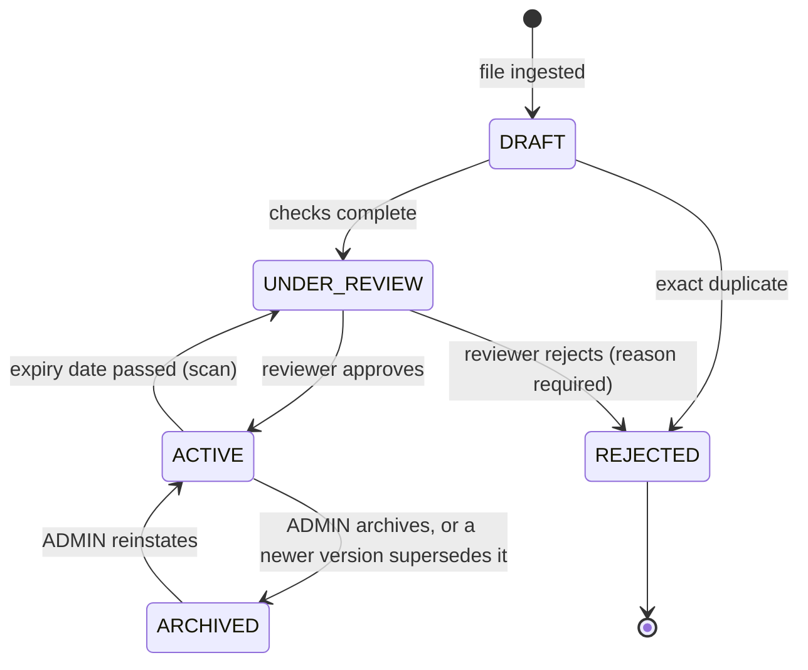

# Document lifecycle

Implemented in `layer1/lifecycle_manager.py` (`ALLOWED`). Any transition not listed raises
`LifecycleViolationError` (HTTP 409) and writes a `LIFECYCLE_VIOLATION` audit event.

| From | To | Who / what triggers it | Audit event |
|---|---|---|---|
| (new) | DRAFT | upload or bulk ingest | `INGEST`, `STATE_TRANSITION` |
| DRAFT | UNDER_REVIEW | automatic, after parse, dedup, chunk, PII, metadata | `STATE_TRANSITION` |
| DRAFT | REJECTED | exact SHA-256 duplicate | `DEDUP_HIT`, `STATE_TRANSITION` |
| UNDER_REVIEW | ACTIVE | SPOC / ADMIN approves; sensitivity set; PII-flagged docs need an override and a reason | `STATE_TRANSITION` |
| UNDER_REVIEW | REJECTED | SPOC / ADMIN rejects with a reason | `STATE_TRANSITION` |
| ACTIVE | ARCHIVED | ADMIN, or "archive superseded" when a new version is approved | `STATE_TRANSITION` |
| ACTIVE | UNDER_REVIEW | `expiry_scanner` finds `expiry_date` in the past | `EXPIRY_TRIGGERED`, `STATE_TRANSITION` |
| ARCHIVED | ACTIVE | ADMIN reinstates | `STATE_TRANSITION` |

REJECTED is terminal: a rejected document is never indexed and is not revived.

## Assumption to be aware of

The brief's section 4.8 requires expired documents to return to review, but its transition table omits
ACTIVE to UNDER_REVIEW. We added that edge because the requirement needs it. It is listed in `design_decisions.md`.

## What each state means for later layers

| State | Searchable by Layer 2 / 3 |
|---|---|
| DRAFT, UNDER_REVIEW, REJECTED | no |
| ACTIVE | yes, subject to the user's ABAC attributes |
| ARCHIVED | no (kept for audit and reinstatement) |
