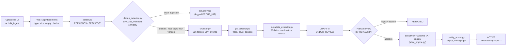
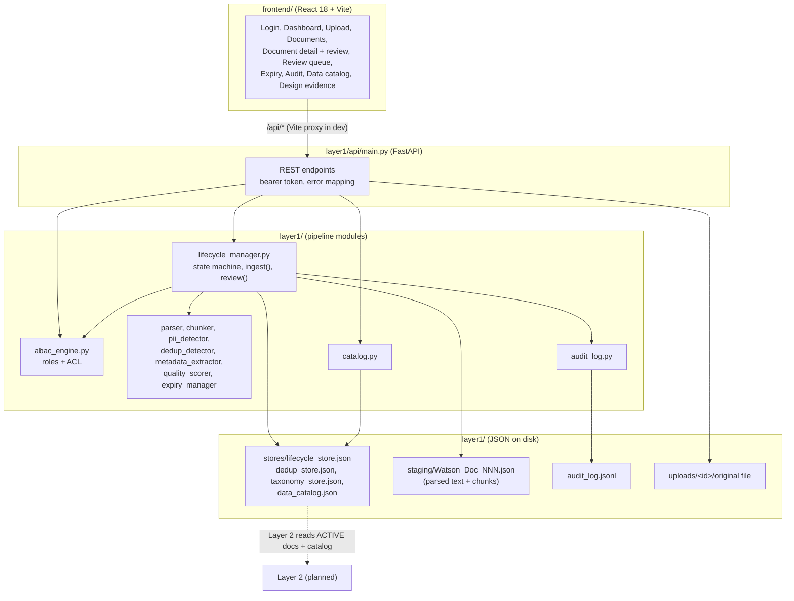

# Layer 1: Governed Ingestion, architecture

Status: **built and tested** (49 automated tests; UI built, not visually checked by us, see `project_status.md`).

## 1. Ingestion pipeline (data flow)

Every box that changes something writes an event to `audit_log.jsonl`
(`INGEST`, `PARSE_WARNING`, `PII_FLAG`, `DEDUP_HIT`, `STATE_TRANSITION`, ...).

## 2. Components

## 3. Who can do what (ABAC)

| Role | Reads up to | Review | Archive / reinstate | Expiry scan, audit |
|---|---|---|---|---|
| VIEWER | INTERNAL | no | no | no |
| ANALYST | RESTRICTED | no | no | no |
| SPOC | all levels | yes, only inside their therapeutic area | no | no |
| ADMIN | all levels | yes | yes | yes |

A document is also filtered by its own ACL (`allowed_therapeutic_areas`, `allowed_geographies`; empty means all).
Documents a user may not see are left out of lists, never shown redacted. Every denial is logged as `ABAC_DENIED`.
Any role may upload; the uploader sees only the status of their own pending document.

## 4. Contract with Layer 2

Layer 2 may index a document only if `lifecycle_manager.assert_indexable(uri)` passes (state is ACTIVE).
It reads chunks from `staging/`, access attributes from the lifecycle record, and the entity inventory from
`stores/data_catalog.json`. Chunk URIs (`Watson:Chunk_NNN_III`) and document URIs (`Watson:Doc_NNN`) are the join keys.
