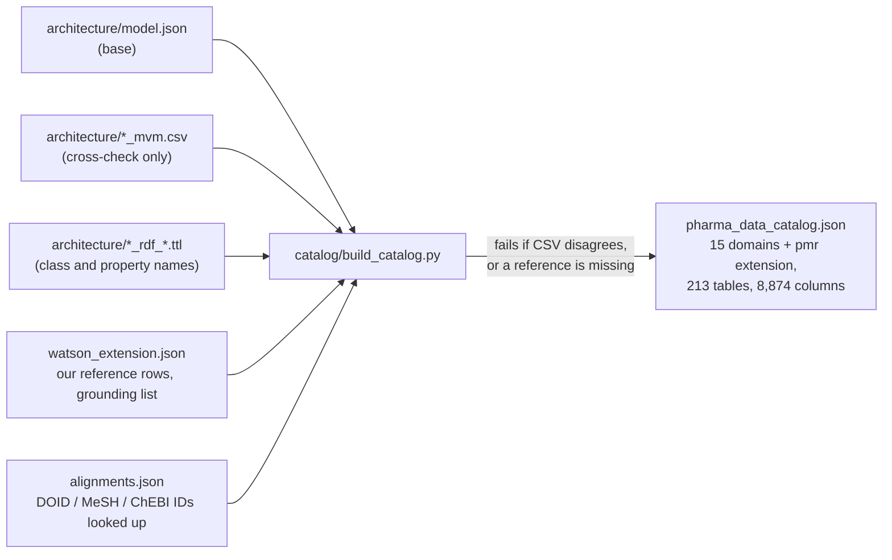
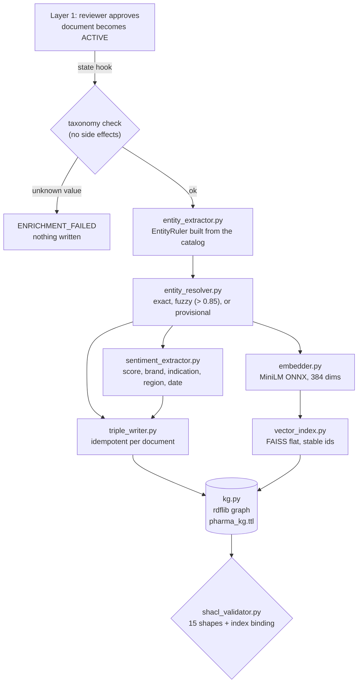
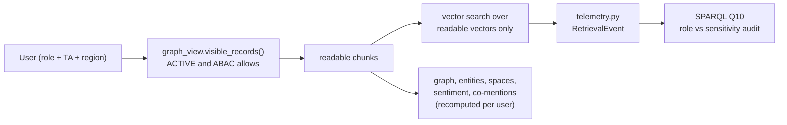
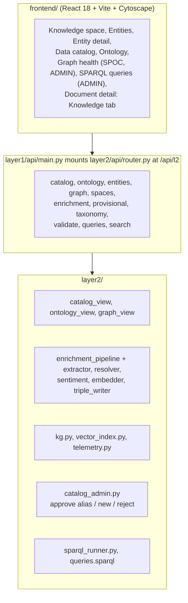

# Layer 2: Semantic Foundation, architecture

Status: **built and tested** (133 Layer 2 tests, 182 with Layer 1; SHACL conforms; UI built but not visually checked by us, see `project_status.md`).

The rule that shapes everything: **the data catalog JSON owns names, synonyms, hierarchy and mappings; `pharma.ttl` owns structure.**
The graph, the vector index and the caches are derived, and `python -m layer2.backfill --reset` rebuilds them.

## 1. From the three model files to the catalog

The three source files are never modified. The catalog version is a fingerprint of its content.

## 2. Enrichment of one approved document

Computed first, written together at the end. A failure logs `ENRICHMENT_FAILED`, rolls back the vectors, and leaves the document ACTIVE.
When a document leaves ACTIVE (archived, expired, reinstated for review) the same hook removes its vectors and recomputes the links between brands.

## 3. Reading: who sees what

## 4. Components and screens

| Screen | Route | Who |
|---|---|---|
| Knowledge space (graph, spaces) | `/knowledge` | all |
| Entities and entity detail (grounding, relations, sentiment) | `/entities`, `/entities/:id` | all (document counts follow access) |
| Data catalog (overview, browse tables, mappings into Watson) | `/data-catalog` | all |
| Ontology (brief minimums, classes, properties, alignments) | `/ontology` | all |
| Graph health (SHACL, enrichment, unrecognised names, taxonomies) | `/graph-health` | SPOC, ADMIN |
| SPARQL queries Q1-Q11 and custom | `/queries` | ADMIN |
| Document detail, Knowledge tab | `/documents/:uri` | per document access |

## 5. Where things live

| What | Where |
|---|---|
| Catalog | `layer2/catalog/pharma_data_catalog.json` |
| Ontology and shapes | `layer2/ontology/pharma.ttl`, `shapes.ttl` |
| Derived stores | `layer2/stores/` (graph, FAISS index, chunk map, enrichment status, entity mentions, provisional names, telemetry) |
| Saved query results | `results/query_results/` (Q1-Q11 as JSON and Markdown) |
