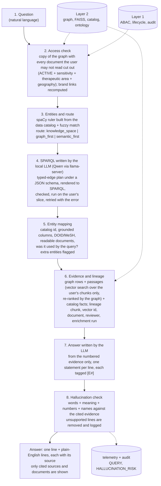

# Layer 3: questions and cited answers

One question goes through eight visible steps. The UI (`/ask`) shows each step as it finishes; the API streams them as newline-delimited JSON (`POST /api/l3/ask`).

## Plain RAG vs semantic RAG (the comparison)

| | Plain RAG | Semantic RAG |
|---|---|---|
| Access check (step 2) | same | same |
| Steps 3-5 (entities, SPARQL, mapping) | skipped | run |
| Evidence | vector cosine only | graph rows + vector ranking boosted by entities named in the question and by what the query points to |
| Answer and check | same model, same hallucination check | same |

## Where the safeguards are

| Risk | Safeguard | Code |
|---|---|---|
| Model reads a restricted document | The query, the entity counts and the vector search all run on the user's slice | `user_graph.py`, `evidence.py` |
| Model writes an invalid or wrong query | Typed grammar, entity-use check, connectivity check, parse, retry with the error, time limit that stops evaluation | `sparql_gen.py` |
| Query reaches outside the machine or changes data | SELECT only, no SERVICE / FROM / updates | `sparql_gen.check` |
| Invented fact in the answer | Per-sentence check against the cited evidence; invented numbers and names are removed | `guard.py` |
| Answer with no source | Uncited lines are kept only if the best evidence clearly supports them (and are marked); otherwise removed | `guard.py` |
| Model not running | Answer is quoted from the evidence and says so; nothing is canned | `answer.py` |

## Files

`layer3/`: `pipeline.py` (the steps), `user_graph.py`, `understand.py`, `sparql_gen.py`, `mapping.py`, `evidence.py`, `answer.py`, `guard.py`, `llm.py` (llama-server client), `start_llm_server.ps1` (starts the model server), `history.py`, `mcp_tools.py` (MCP-shaped stubs, not a server), `api/router.py`, `tests/`.
