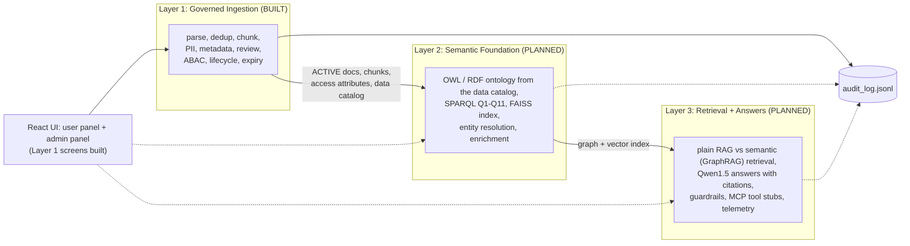

# Watson: system overview

Only Layer 1 is built. Layers 2 and 3 are planned; their boxes below are the intended design, not working code.
Each layer gets its own diagram file in this folder when it is built.

Solid lines exist today; dotted lines are planned.

## Folder map

| Folder / file | Purpose |
|---|---|
| `layer1/` | All Layer 1 code, data, stores, tests |
| `layer2/`, `layer3/` | Empty placeholders |
| `frontend/` | React UI |
| `architecture/` | These diagrams |
| `results/` | Evidence files (chunking comparison runs, ingest summary) |
| `README.md` | Milestones and run instructions |
